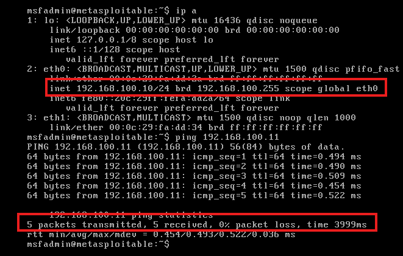
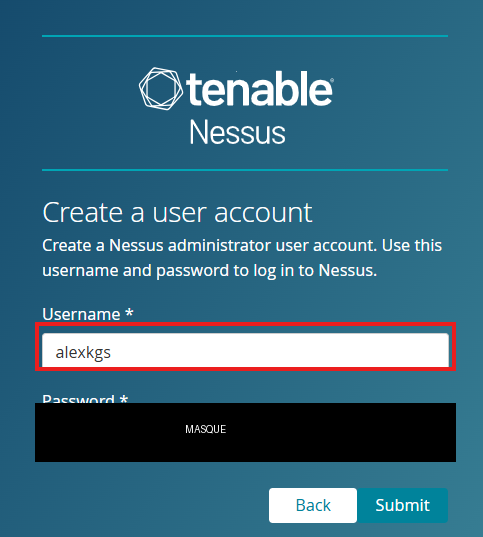
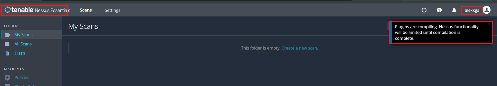

# Découverte et exploitation de vulnérabilités

**Runtrack La Plateforme — Administrateur d'Infrastructures Sécurisées**
Alexandre Kegresse · Soutenance du 30 octobre 2026

Outils : **Nessus (Tenable)** pour la détection, **Metasploit** pour l'exploitation.
Cible : **Metasploitable 2**, machine volontairement vulnérable, dans un lab **isolé**.

> ⚠️ Tout ce travail est réalisé sur mes propres VM, dans un réseau fermé, à des fins
> d'apprentissage. Scanner ou exploiter une machine sans autorisation est illégal.

---

## Le lab

Hyperviseur : **VMware Workstation**.

| Machine | Rôle | Réseau / IP |
|---|---|---|
| Debian 13 + Nessus + Metasploit | Attaquant / scanner | NAT (VMnet8) `192.168.58.161` pour Internet **+** host-only (VMnet1) `192.168.100.11` (interface `ens34`) pour atteindre la cible |
| Metasploitable 2 | Cible vulnérable | host-only (VMnet1) `192.168.100.10` (`eth0`) — **jamais** d'accès Internet |

Choix réseau : la cible reste **isolée** en host-only ; la VM attaquante a une 2ᵉ carte NAT
uniquement pour télécharger les paquets (Nessus, Metasploit). Les deux VM se voient sur le
réseau host-only `192.168.100.0/24` (DHCP activé sur VMnet1).

Liaison vérifiée : **ping bidirectionnel OK** entre `192.168.100.11` et `192.168.100.10`
(0 % de perte).

---

## Job 01 — Présentation de Nessus

Documentation dédiée : [`docs/01-nessus-presentation.md`](docs/01-nessus-presentation.md).
Reprise synthétique dans le support de soutenance.

## Job 02 — VM Metasploitable 2

VM importée sous VMware (fichier `.vmx` déjà fourni dans l'archive), carte réseau en
**host-only** (VMnet1). Connexion `msfadmin` / `msfadmin`, adresse obtenue en DHCP :
**192.168.100.10** (`eth0`). La cible et l'attaquant se pingent (0 % de perte).

## Job 03 — VM Debian + Nessus

Debian 13 réutilisée depuis un OVA, **2 cartes réseau** (NAT pour Internet + host-only
`192.168.100.11`). Nessus Essentials téléchargé et installé en ligne de commande, service
`nessusd` démarré, puis configuration depuis le navigateur de l'hôte
(`https://192.168.100.11:8834`).

Création du compte administrateur (mot de passe **masqué** dans la capture) :

Nessus Essentials opérationnel, compilation des plugins en cours :

## Job 04 — Scan et analyse

*À compléter : scan « Basic Network Scan » sur la cible, vulnérabilités critiques
trouvées, type de chaque vulnérabilité.*
Captures : `captures/job04-scan/`

| Vulnérabilité | Service / port | Sévérité | CVE | Type |
|---|---|---|---|---|
| *à compléter* | | | | |

## Job 05 — Exploitation d'une vulnérabilité

*À compléter : vulnérabilité choisie, module Metasploit, payload utilisée et ce
qu'elle fait, accès obtenu.*
Captures : `captures/job05-exploit/`

## Job 06 — Accès non autorisé + post-exploitation

*À compléter : exploitation d'une vulnérabilité critique (ex. SMB/Samba), accès au
système, actions de post-exploitation (collecte d'infos, privilèges).*
Captures : `captures/job06-postexploit/`

## Job 07 — Correction des vulnérabilités

*À compléter : correctifs proposés, importance des mises à jour et des audits.*
Captures : `captures/job07-remediation/`

---

## Bonnes pratiques appliquées

- Lab **isolé** du réseau réel (cible volontairement vulnérable).
- Aucun mot de passe ni clé en clair dans les captures ou le dépôt.
- On documente aussi ce qui ne marche pas, avec le diagnostic.
